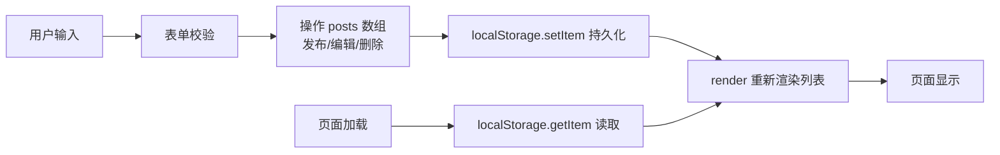

## 产品概述

QL-BLog：一个简化版的微博式日志应用，纯前端实现，无后端。用户在本地浏览器打开后，可以发布、浏览、编辑和删除日志，所有数据保存在浏览器 Local Storage 中，刷新或关闭页面后数据不丢失。

## 核心功能

- 发布日志：输入文字内容（可选标题），点击发布按钮创建新日志，发布后输入框清空
- 日志列表：按时间倒序展示所有日志，显示内容、发布时间和字符数
- 编辑日志：对已有日志进行修改并保存
- 删除日志：删除单条日志（需确认），支持一键清空全部日志
- 空状态与统计：无日志时显示友好提示，顶部展示日志总数
- 数据持久化：基于 Local Storage 存储，页面加载时自动读取并渲染

## 边界与约束

- 单文件双击打开即可使用（file:// 协议），不依赖任何服务器、构建工具或框架
- 空内容不可发布（输入校验 + 按钮禁用态）
- Local Storage 读写需做异常兜底（数据损坏时降级为空列表）
- 代码结构简单、注释充分，适合 AI 开发新手阅读学习

## 技术栈

- 页面结构：原生 HTML5（单页应用，一个 index.html）
- 样式：原生 CSS3（styles.css，含 flex/grid 布局、过渡动画）
- 逻辑：原生 JavaScript（ES6，app.js，无框架无构建）
- 数据存储：浏览器 Local Storage（key 统一为 `ql-blog-posts`）

## 实现方案

### 架构

纯前端单页应用，数据流单向清晰：



### 关键设计决策

1. **数据层集中管理**：用一个 `posts` 数组 + `save()`/`load()` 两个函数封装 Local Storage 读写，所有增删改操作只改数组后统一 `save() + render()`，避免多处直接操作存储导致状态不一致。
2. **时间戳作为唯一 id**：`Date.now()` 生成 id，简单可靠，无需引入 UUID 库。
3. **事件委托渲染**：列表整体重绘（innerHTML 拼接），日志量小（个人使用）性能足够；编辑/删除按钮通过 `data-id` 属性定位目标日志。
4. **XSS 防护**：渲染用户输入时进行 HTML 转义（`<`、`>`、`&`、引号），这是纯前端存储型应用必须的安全点。
5. **异常兜底**：`load()` 中对 JSON.parse 用 try/catch，解析失败时返回空数组并清理脏数据。

## 目录结构

```
c:/Users/USER434852/CodeBuddy/20261112155015/
├── index.html   # [NEW] 页面结构：头部统计栏、发布表单（标题输入+内容文本域+发布按钮）、日志列表容器、清空按钮
├── styles.css   # [NEW] 全部样式：布局、卡片列表、表单、按钮、空状态、过渡动画，响应式适配移动端
├── app.js       # [NEW] 核心逻辑：load/save 数据层、render 渲染、发布/编辑/删除/清空事件处理、HTML 转义工具函数
└── README.md    # [NEW] 使用说明：如何本地打开、功能列表、数据存储说明（key 位置、如何备份/清空）
```

## 实现要点

- 所有代码带中文注释，函数命名清晰，便于新手理解
- 按钮禁用态与输入校验防止发布空日志；删除使用 `confirm()` 原生确认框（最小可用原则）
- 时间显示使用 `toLocaleString()` 本地化格式
- 不引入任何第三方依赖，保证 file:// 协议下直接可用

## 设计风格

采用清新简洁的社交媒体卡片流风格（参考微博/朋友圈的轻量化设计）：单列居中布局，白色卡片承载日志，柔和浅色背景，圆角与轻阴影营造轻盈感，微交互（按钮 hover、卡片淡入）提升体验。

## 页面结构（单页 4 个区块，自上而下）

1. **顶部标题栏**：应用名 "QL-BLog" + 日志总数徽章，简洁 logo 感
2. **发布区卡片**：标题输入框（单行）+ 内容文本域（多行，自动提示剩余/已输入字数）+ 发布按钮（主色，禁用态变灰）
3. **日志列表区**：倒序卡片流，每张卡片显示标题、正文、发布时间与字数，卡片右上角"编辑/删除"文字按钮
4. **底部操作栏**：清空全部按钮（红色警示样式）+ 版权说明小字

## 交互细节

- 卡片进入时轻微淡入上移动画；按钮 hover 有颜色加深与位移反馈
- 删除操作弹出原生 confirm；发布成功后输入框清空并聚焦
- 移动端（<600px）表单与卡片自动铺满宽度，字体自适应

## Agent Extensions

### Skill

- **playwright-cli**
- Purpose：在实现完成后自动化打开页面，验证发布、编辑、删除、清空功能及刷新后数据持久化是否正常
- Expected outcome：浏览器实测通过，确认核心功能与 Local Storage 持久化均正常工作